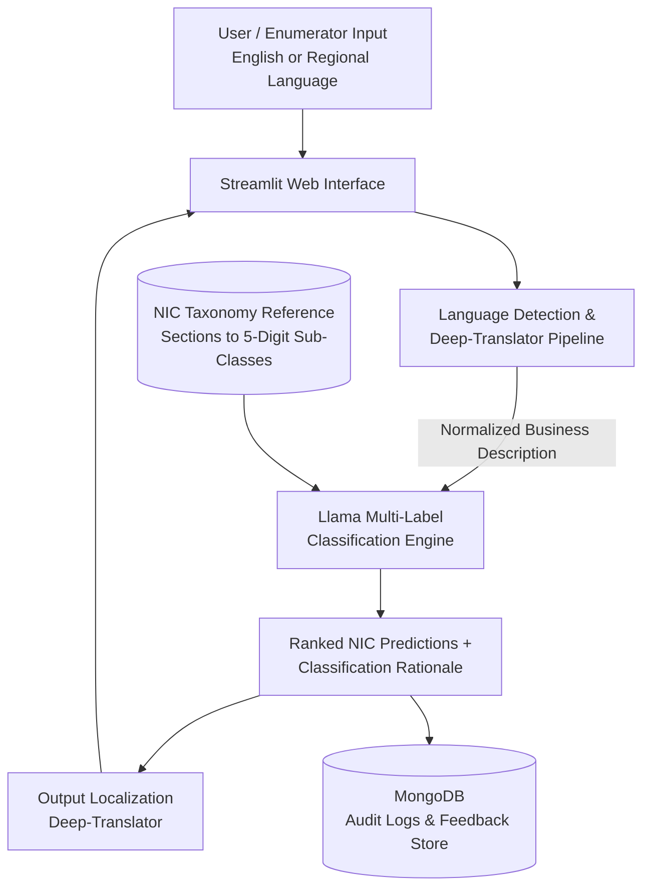

# GovIntel.AI — LLM-Powered National Industrial Classification (NIC) System

[](https://www.python.org/)
[](https://streamlit.io/)
[](https://llama.meta.com/)
[](https://www.mongodb.com/)
[](https://pypi.org/project/deep-translator/)
[](LICENSE)

> **GovIntel.AI** is a multilingual, LLM-driven multi-label classification platform built to automate **National Industrial Classification (NIC)** code identification—reducing manual lookup latency and classification errors across government surveys, MSME registrations, and regulatory workflows.

---

## 1. Project Overview & Problem Statement

### The Challenge
India's **National Industrial Classification (NIC)** standard—maintained by the Ministry of Statistics and Programme Implementation (MoSPI)—organizes economic activities into a granular 5-digit hierarchy spanning **Sections, Divisions, Groups, Classes, and Sub-classes**.

In enterprise registrations (Udyam/MSME), GST filings, and national economic surveys, assigning accurate NIC codes presents major operational hurdles:
1. **High Lookup Latency:** Enumerators and business owners must manually search thousands of dense, bureaucratic NIC descriptions to find matching codes.
2. **Semantic Vocabulary Mismatch:** Real-world business descriptions (e.g., *"cloud kitchen supplying packaged meals via delivery apps"*) rarely match rigid statutory phrasing, causing keyword-search failures and misclassification.
3. **Linguistic Barriers:** Field enumerators and small business operators frequently describe economic activities in regional Indian languages rather than formal English.

### The Solution
**GovIntel.AI** replaces brittle keyword lookups with an end-to-end **Llama-powered semantic multi-label classifier**. Integrated with **Deep-Translator** for multilingual accessibility, **Streamlit** for an intuitive stakeholder interface, and **MongoDB** for audit logging, the platform maps natural-language business descriptions to accurate hierarchical NIC codes in seconds.

---

## 2. Core Capabilities

* **Multi-Label Hierarchical NIC Classification:** Leverages **Llama** semantic reasoning to evaluate complex or multi-activity enterprise descriptions and predict primary and secondary 5-digit NIC codes with clear explanatory rationale.
* **Multilingual Input & Output (`Deep-Translator`):** Automatically detects and translates regional language business descriptions into normalized English prior to classification—and translates results back for non-English-speaking stakeholders.
* **Accessible Stakeholder Interface (`Streamlit`):** Delivers a clean, zero-training-required web portal tailored for field enumerators, MSME applicants, and policy analysts.
* **Audit Trail & Analytics Persistence (`MongoDB`):** Stores classification histories, original/translated inputs, predicted NIC hierarchies, and user verification feedback in MongoDB to support governance audits and continuous accuracy tracking.

---

## 3. System Architecture



### Architectural Breakdown

| Layer | Technology | Role in System |
| :--- | :--- | :--- |
| **Presentation Layer** | `Streamlit` | Interactive UI for entering business descriptions, inspecting multi-label NIC predictions, and submitting validation feedback. |
| **Localization Layer** | `Deep-Translator` | Bridges regional linguistic gaps by translating vernacular inputs and localizing classification explanations. |
| **Classification Engine** | `Llama (LLM)` | Performs semantic disambiguation and multi-label mapping against the 5-tier NIC taxonomy. |
| **Data & Audit Layer** | `MongoDB` | Persists query logs, model predictions, latency metrics, and human-in-the-loop feedback records. |

---

## 4. Repository Structure

```text
GovIntel.AI/
├── app.py                         # Streamlit frontend application & UI state management
├── src/
│   ├── classifier/
│   │   ├── llama_engine.py        # Llama prompt engineering & multi-label NIC inference
│   │   └── taxonomy_mapper.py     # Hierarchical NIC code validation & metadata enrichment
│   ├── translator/
│   │   └── multilingual.py        # Deep-Translator language detection & translation wrapper
│   ├── database/
│   │   └── mongo_client.py        # MongoDB connection, audit logging & feedback persistence
│   └── utils/
│       └── config.py              # Environment variable & constant management
├── data/
│   └── nic_taxonomy.json          # Structured NIC hierarchy reference dataset
├── .env.example                   # Environment configuration template
├── requirements.txt               # Python dependencies
└── README.md
```

---

## 5. Setup & Local Installation Guide

### Prerequisites
* **Python** 3.10 or higher
* **MongoDB** 6.0+ (local instance or MongoDB Atlas cluster)
* **Llama Model Access** (via local Ollama runtime or hosted inference endpoint)

### Step 1: Clone the Repository
```bash
git clone [https://github.com/ernakulsharma/GovIntel.AI.git](https://github.com/ernakulsharma/GovIntel.AI.git)
cd GovIntel.AI
```

### Step 2: Create a Virtual Environment & Install Dependencies
```bash
python -m venv venv
source venv/bin/activate        # On Windows: venv\Scripts\activate
pip install --upgrade pip
pip install -r requirements.txt
```

### Step 3: Configure Environment Variables
Copy `.env.example` to `.env` and populate your MongoDB URI and Llama inference settings:
```bash
cp .env.example .env
```

```env
# MongoDB Configuration
MONGO_URI=mongodb://localhost:27017
MONGO_DB_NAME=govintel_db
MONGO_COLLECTION_LOGS=classification_logs

# Llama Inference Configuration
LLM_PROVIDER=ollama
LLAMA_MODEL_NAME=llama3
LLM_BASE_URL=http://localhost:11434
```

### Step 4: Launch the Streamlit Application
```bash
streamlit run app.py
```
The web interface will open automatically at **`http://localhost:8501`**.

---

## 6. Example Classification Workflow

1. **Input (Hindi / Regional or English):**  
   *"हम छोटे पैमाने पर जैविक मसालों की पिसाई, पैकेजिंग और ऑनलाइन बिक्री करते हैं।"*  
   *(Translated: "We carry out small-scale grinding, packaging, and online retail of organic spices.")*
2. **Multi-Label Output:**
   * **Primary NIC Code:** `10795` — *Manufacture of papads, appalam and similar food products / grinding and processing of spices* (Section C — Manufacturing)
   * **Secondary NIC Code:** `47912` — *Retail sale via e-commerce / internet* (Section G — Wholesale and Retail Trade)
3. **Audit Record:** Logged automatically to MongoDB with timestamp, original text, translated text, predicted codes, and user confirmation status.

---

## 7. Future Roadmap

 **Bulk Survey CSV Processing:** Asynchronous batch classification pipeline for large-scale enterprise survey datasets.
 **Hybrid Vector + LLM Retrieval:** Pre-filter top-20 candidate NIC nodes via dense embeddings before Llama re-ranking to reduce token latency.
 **REST API Microservice:** Expose a FastAPI endpoint for direct integration into state MSME and municipal licensing portals.

---

## 8. Author

**Nakul Sharma**  
B.E. in Computer Science & Business Systems — Thapar Institute of Engineering and Technology  
GitHub: [@ernakulsharma](https://github.com/ernakulsharma)
